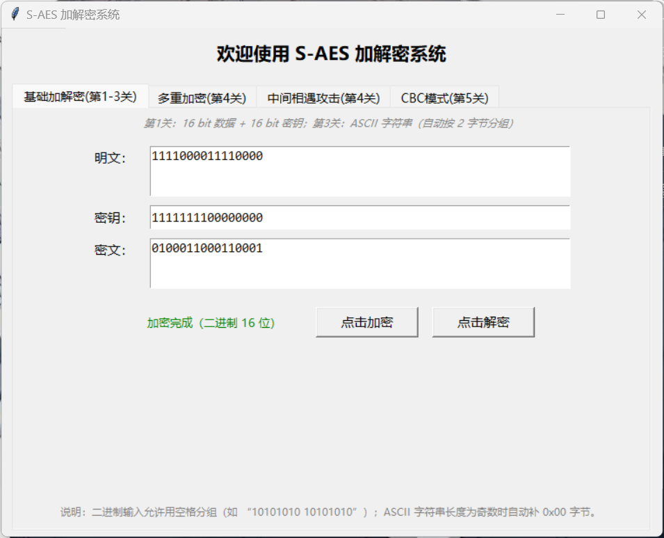
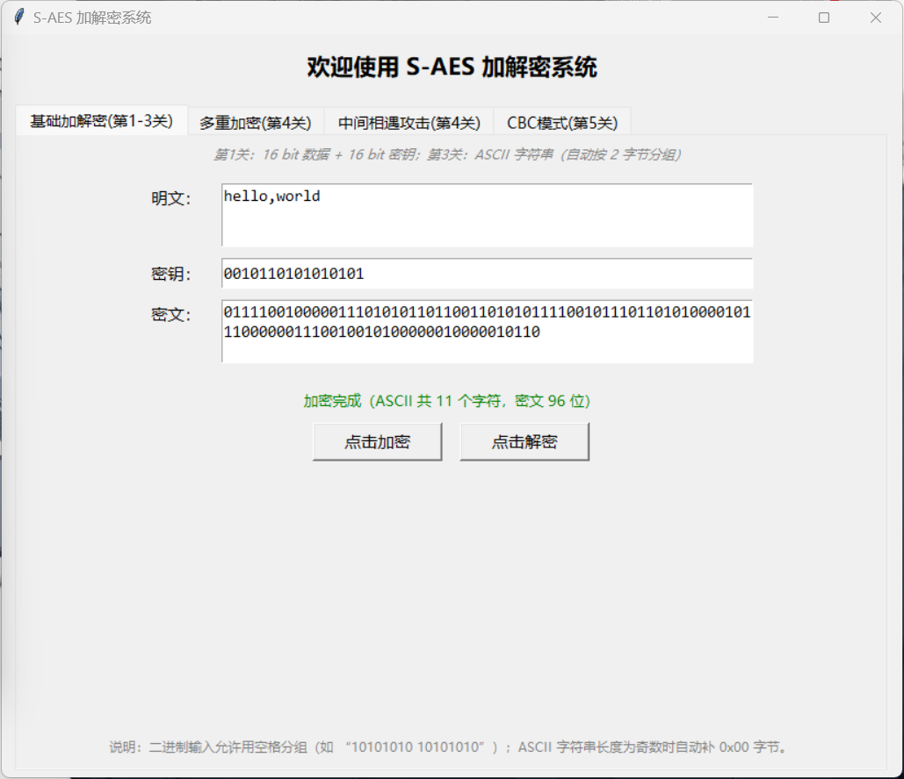
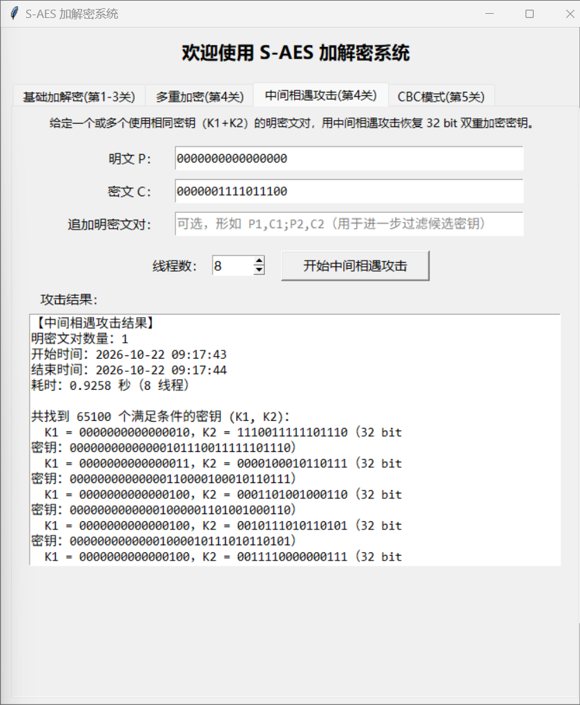
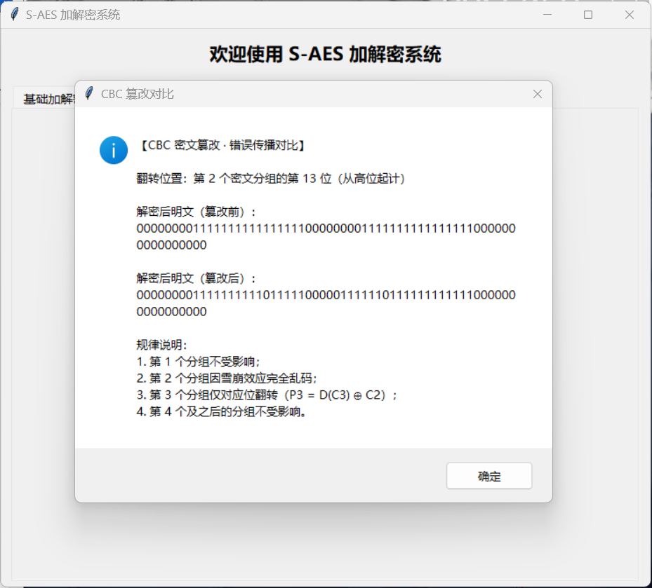

# S-AES 加解密系统

> 《信息安全导论》课程作业 2 · S-AES 算法实现

依据《密码编码学与网络安全——原理与实践（第 8 版）》附录 D 的简化 AES 标准编写，
使用 Python 3 + Tkinter 实现，只用到标准库，不需要安装第三方包。
包含作业要求的五个关卡：基础加解密、交叉测试、ASCII 字符串扩展、多重加密与中间相遇攻击、CBC 工作模式。

---

## 项目简介

S-AES（Simplified AES）是完整 AES 的简化教学版本：分组长度与主密钥均为 **16 bit**，状态组织为 2×2 半字节矩阵，加密过程要经过密钥扩展、轮密钥加、半字节代替、行移位与列混淆几个环节。本程序按教材附录 D 的约定实现，并在此基础上增加了 ASCII 字符串加解密、32/48 bit 多重加密、中间相遇攻击和 CBC 工作模式，这些功能都通过图形界面操作。

**小组成员（小组名称：no.1501）**

| 组员 | 学号 | 姓名 |
|------|------|------|
| 组员一 | 20241459 | 牙雁玮 |
| 组员二 | 20241120 | 张匀慈 |



---

## 目录

- [功能概览](#功能概览)
- [快速开始](#快速开始)
- [项目结构](#项目结构)
- [模块设计](#模块设计)
- [测试结果摘要](#测试结果摘要)
- [标准测试向量](#标准测试向量附录-d)
- [实现说明](#实现说明)
- [文档](#文档)
- [许可证](#许可证)

---

## 功能概览

| 关卡 | 功能 | 状态 |
|------|------|:----:|
| 第 1 关 | 16 bit 数据 + 16 bit 密钥的基础加解密 | ✅ |
| 第 2 关 | 交叉测试：与另一小组（随便吧）使用相同算法标准互验 | ✅ |
| 第 3 关 | ASCII 字符串加解密（按 2 字节分组，奇数长度自动补 0x00） | ✅ |
| 第 4 关 | 双重加密（32 bit）、三重加密（48 bit）、中间相遇攻击 | ✅ |
| 第 5 关 | CBC 密码分组链模式 + 密文篡改错误传播实验 | ✅ |

## 算法标准

- **分组与密钥**：分组长度 16 bit，主密钥 16 bit，状态为 2×2 半字节（nibble）矩阵
- **S 盒 / 逆 S 盒**：附录 D 表 D.1(a)/(b)，展平为一维数组直接查表
- **列混淆矩阵**：`[1 4; 4 1]`，逆矩阵 `[9 2; 2 9]`，乘法在 GF(2⁴) 上以 x⁴+x+1 为模
- **轮常数**：RCON1=`10000000`、RCON2=`00110000`
- **加密流程**：`AK0 → (NS+SR+MC+AK1) → (NS+SR+AK2)`；解密为严格逆序

## 快速开始

### 环境要求

| 项 | 要求 |
|----|------|
| 操作系统 | Windows 10/11、macOS、Linux |
| Python | 3.6 及以上 |
| 依赖 | 仅标准库（tkinter、concurrent.futures、threading、random、datetime） |

### 运行

```bash
# 进入项目目录后启动图形界面
python src/saes.py
```

程序启动后弹出主窗口，顶部四个选项卡分别对应五个关卡：

| 选项卡 | 对应关卡 |
|--------|----------|
| 基础加解密 | 第 1、2、3 关 |
| 多重加密 | 第 4 关（双重 / 三重） |
| 中间相遇攻击 | 第 4 关 |
| CBC 模式 | 第 5 关 |

## 项目结构

```
S-AES/
├── src/
│   └── saes.py              # 主程序（SAESCore + SAESUtils + SAESGUI，单文件）
├── docs/
│   ├── 用户指南.docx         # 用户操作指南
│   ├── 开发文档.docx         # 架构设计、算法原理、接口文档
│   └── 测试结果.docx         # 五关测试结果与数据分析（含运行截图）
├── screenshots/             # 实际运行截图（分关卡存放）
└── README.md                # 本文件
```

## 模块设计

```
saes.py
├── SAESCore  核心加解密算法（纯函数，无副作用）
│   ├── key_expansion(key)     密钥扩展 → (K0, K1, K2)
│   ├── encrypt_block(p, key)  单块加密 → 16 bit 密文
│   ├── decrypt_block(c, key)  单块解密 → 16 bit 明文
│   └── encrypt / decrypt      16 位二进制字符串包装
├── SAESUtils 扩展功能
│   ├── str_to_bin / bin_to_str / encrypt_ascii / decrypt_ascii   ASCII 编解码
│   ├── double_encrypt_block / triple_encrypt_block               多重加密
│   ├── meet_in_the_middle(pairs, workers)                        中间相遇攻击
│   └── cbc_encrypt_bits / cbc_decrypt_bits / tamper_cipher_block CBC 模式
└── SAESGUI   Tkinter 图形界面（四选项卡）
```

## 测试结果摘要

> 以下数据均来自程序实际运行截图，完整版见 [docs/测试结果.docx](docs/测试结果.docx)。

### 第 1 关：基础加解密

输入 16 bit 明文与 16 bit 密钥，输出 16 bit 密文并可无损还原；另以 **2000 组随机明文/密钥往返测试，全部通过**。

| 明文 P | 密钥 K | 密文 C（实测） |
|--------|--------|----------------|
| `1111000011110000` | `1111111100000000` | `0100011000110001` |
| `1111000011111111` | `1111111100000000` | `0011011000110100` |
| `1111000011110000` | `1010101010101010` | `0011000100100011` |
| `0101010101010101` | `1010101010101010` | `1000101010010110` |
| `0101010101010101` | `1111111111111111` | `1111101011101110` |

### 第 2 关：交叉测试

本组（**no.1501**）与另一小组（**随便吧**）约定相同明文与密钥，分别运行各自程序加密并核对密文：

| 交叉用例 | 输入 | 本组结果 | 随便吧结果 | 判定 |
|----------|------|----------|------------|:----:|
| 单重加密 | P=`F0F0`, K=`FF00` | `4631` | `4631` | ✅ 一致 |
| 双重加密 | P=`0000`, K1=`2D55`, K2=`A1F3` | `03DC` | `03DC` | ✅ 一致 |
| 三重加密 | P=`0000`, K1=`2D55`, K2=`A1F3`, K3=`B276` | `AA79` | `AA79` | ✅ 一致 |

双方密文完全一致，交叉测试通过。

### 第 3 关：ASCII 字符串扩展

明文 `hello,world`（11 字符，奇数长度自动补 0x00），密钥 `0010110101010101`（2D55）：

- 密文：`0111100100000111010101101100110101011110010111011010100000101100 00001110010010100000010000010110`
- 解密后还原为 `hello,world`，状态栏显示「加密完成（ASCII 共 11 个字符，密文 96 位）」



### 第 4 关：多重加密与中间相遇攻击

| 测试项 | 输入 | 实测结果 |
|--------|------|----------|
| 双重加密 | P=`0000000000000000`, K1=`2D55`, K2=`A1F3` | C=`0000001111011100`，解密还原 ✅ |
| 三重加密 | P=`0000000000000000`, K1=`2D55`, K2=`A1F3`, K3=`B276` | C=`1010101001111001`，解密还原 ✅ |
| 中间相遇攻击 | P=`0000000000000000`, C=`0000001111011100`（8 线程） | 单个明密文对得到 65100 个候选密钥，耗时约 0.93 秒（随机器的不同会有出入）；再追加一组明密文对后收敛为唯一解 K1=`2D55`, K2=`A1F3` |



### 第 5 关：CBC 工作模式与篡改

64 bit 明文分 4 组，IV=`AAAA`，K=`2D55`，密文 `DCD5 3D0F 3C07 E18B`，解密完整还原。篡改第 2 个密文分组的某一位后：

| 明文分组 | 篡改后的影响 |
|----------|--------------|
| 第 1 组 | ✅ 不受影响 |
| 第 2 组 | ❌ 因解密雪崩完全乱码 |
| 第 3 组 | ⚠️ 仅对应位翻转（P3 = D(C3) ⊕ C2） |
| 第 4 组及之后 | ✅ 不受影响 |



## 标准测试向量（附录 D）

| 测试项 | 输入 | 输出 |
|--------|------|------|
| 单重加密 1 | P=`F0F0`, K=`FF00` | C=`4631` |
| 单重加密 2 | P=`F0FF`, K=`FF00` | C=`3634` |
| 单重加密 3 | P=`F0F0`, K=`AAAA` | C=`3123` |
| 单重加密 4 | P=`5555`, K=`AAAA` | C=`8A96` |
| 单重加密 5 | P=`5555`, K=`FFFF` | C=`FAEE` |
| 密钥扩展 | 主密钥 `2D55` | K0=`2D55`, K1=`BCE9`, K2=`A34A` |
| 双重加密 | P=`0000`, K1=`2D55`, K2=`A1F3` | C=`03DC` |
| 三重加密 | P=`0000`, K1=`2D55`, K2=`A1F3`, K3=`B276` | C=`AA79` |
| CBC 加密 | P=`00FFFF00FFFF0000`, IV=`AAAA`, K=`2D55` | C=`DCD5 3D0F 3C07 E18B` |

## 实现说明

- **GF(2⁴) 乘法查表**：程序启动时生成完整的乘法表 `_GF_MUL[16][16]`，并单独取出列混淆要用到的 `_MUL2`、`_MUL4`、`_MUL9`，之后都走查表，避免重复做移位和化简
- **中间相遇攻击并行**：用 `ThreadPoolExecutor` 分段并行枚举 K1 建表，`defaultdict(list)` 收集中间值；GUI 中把这段计算放到后台线程，攻击过程中窗口仍能操作
- **CBC 篡改演示**：翻转指定密文分组的一位后解密，弹窗列出篡改前后的明文，便于观察雪崩效应和错误传播范围
- **状态栏显示**：第 1 关状态栏用 `wraplength` 自动换行，字符数、密文位数等长提示可以完整显示
- **分层结构**：核心算法写成无副作用的纯函数，与界面无关，可以单独调用，也方便做自动化测试

## 文档

| 文档 | 内容 |
|------|------|
| [docs/用户指南.docx](docs/用户指南.docx) | 运行环境、启动方式、五关操作步骤、常见问题、标准用例 |
| [docs/开发文档.docx](docs/开发文档.docx) | 系统架构、算法原理、接口文档、关键实现说明 |
| [docs/测试结果.docx](docs/测试结果.docx) | 五关测试数据与运行截图、测试结论 |

## 许可证

本项目为课程作业，仅供学习交流使用。
