# S-DES 加解密系统

## 📖 项目简介

本项目为《信息安全导论》课程第 5 次课作业，基于 **S-DES（Simplified DES）** 算法标准，使用 **Python** 语言与 **Tkinter** 图形库开发。项目完整实现了课程要求的五个关卡：基础加解密、交叉测试、ASCII 字符串扩展、并行暴力破解（含时间戳与性能对照实验）以及密钥碰撞封闭测试。

算法参数严格遵循课程给定的标准设定：分组长度 8-bit、密钥长度 10-bit，P10 / P8 / IP / IP⁻¹ / EP / SP / 移位表 / S-Box1 / S-Box2 全部按标准实现（其中 S-Box2 采用文档中"以此处为准"的修正版本）。

## ✨ 功能特性

| 关卡    | 功能       | 实现情况                                                |
|:----- |:-------- |:--------------------------------------------------- |
| 第 1 关 | 基础加解密    | 8-bit 明文 + 10-bit 密钥 → 8-bit 密文，可无损解密还原             |
| 第 2 关 | 交叉测试     | 算法流程与转换单位与标准一致，已与其他小组程序比对结果                         |
| 第 3 关 | ASCII 扩展 | 任意长度字符串按 1 Byte 分组加解密，解密后还原原始文本                     |
| 第 4 关 | 暴力破解     | 遍历 1024 个密钥，支持 **多进程 / 多线程 / 串行** 三种模式，输出匹配密钥与系统时间戳 |
| 第 5 关 | 密钥碰撞     | 固定明文遍历全部密钥，统计碰撞密文与卷入碰撞的密钥数量                         |

其他特性：

- 支持在二进制串中使用空格分组书写（如 `10101010 10101010` 会被正确解析为 16 位二进制）
- 解密结果若为可打印 ASCII 文本则直接还原为文本，否则以二进制串展示
- 输入框支持多行文本、右键复制 / 粘贴 / 全选

## 📂 项目目录结构

```text
S-DES-Implementation/
├── src/
│   └── sdes.py                  # 主程序（核心算法 + 工具函数 + GUI 界面）
├── docs/
│   ├── 用户指南.docx             # 详细操作说明
│   ├── 开发文档.docx             # 模块设计与接口说明
│   └── 测试结果文档.docx         # 五个关卡的测试过程与结果
├── screenshots/                 # 测试结果截图
└── README.md                    # 项目说明文档
```

## 🚀 运行环境与安装

### 环境要求

- 操作系统：Windows 10/11、macOS、Linux
- 编程语言：Python 3.6 及以上
- 依赖库：Tkinter、`concurrent.futures`、`collections`、`datetime`、`os`、`time` —— 全部为 Python 内置标准库，无需安装任何第三方包

### 启动步骤

```bash
# 1. 克隆或下载本仓库到本地
git clone <你的仓库地址>

# 2. 进入项目根目录，运行主程序
python src/sdes.py
```

程序启动后，将弹出名为"S-DES 加解密系统"的图形界面窗口。

> ⚠️ 若从旧版本迁移，请注意源码文件名已由 `S-DES 2026.py` 改为 `sdes.py`（去掉文件名中的空格，避免命令行把文件名拆成两个参数）。

## 📝 使用指南

### 1. 基本加解密（第 1 关）

- 明文框输入 `10101010`，密钥框输入 `1111100000`
- 点击"点击加密"，密文框输出 `00111011`
- 点击"点击解密"，明文框还原为 `10101010`

### 2. 交叉测试（第 2 关）

- 明文框输入 `11001100`，密钥框输入 `1010101010`
- 加密结果为 `10110001`，与其他小组遵循同一标准的程序比对一致

### 3. ASCII 扩展测试（第 3 关）

- 明文框输入 `this is a test`（14 个字符，共 112 bit）或 `hello world!`（共 96 bit）
- 输入 10 位密钥后点击"点击加密"，密文框输出等长的二进制串
- 复制密文到密文框，点击"点击解密"，明文框直接还原为原始文本 `this is a test`

### 4. 暴力破解（第 4 关）

- 明文框输入 `00110101`，密文框输入 `11001101`

- 点击"暴力破解测试"，弹窗展示**开始时间 / 结束时间 / 耗时**，以及全部匹配密钥：

  ```
  0110001101、0111000101、1010001111、1011000111
  ```

- 点击"并行性能对比"，可查看串行 / 多线程 / 多进程三种模式的耗时与加速比（见下方性能结论）

- 完整破解过程（含时间戳与耗时）见下方"测试结果截图 → 第 4 关"中的动图演示

### 5. 密钥碰撞测试（第 5 关）

- 明文框输入 `00110101`，点击"密钥碰撞测试"
- 实测结果：遍历全部 1024 个密钥，**1008 个密钥卷入了碰撞**，共 **223 个密文**由多个密钥产生，单个密文最多对应 **12 个密钥**
- 结论：**同一个明密文对无法唯一确定密钥**，第 4 关找到多个匹配密钥正是这一特性的直接体现

## 📸 测试结果截图

### 初始界面

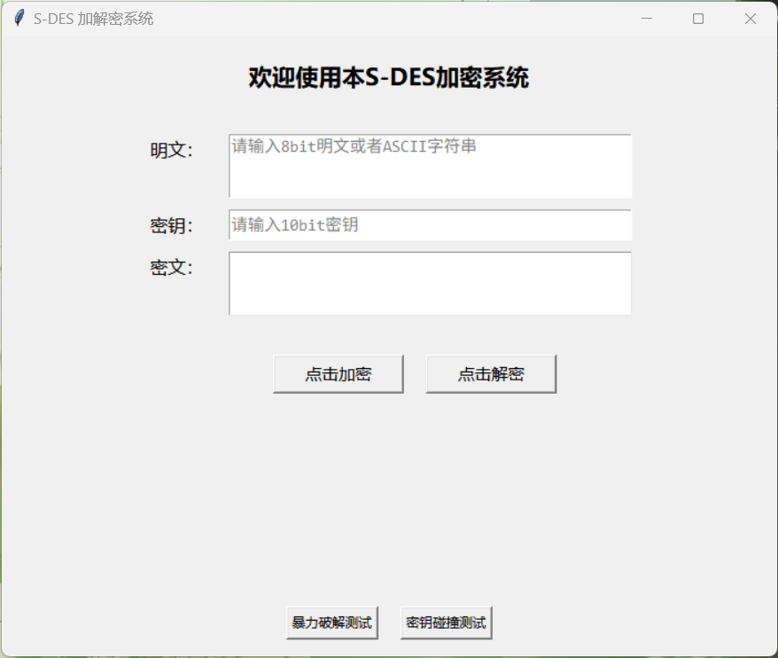

### 第 1 关：基础加解密与输入校验

| 基础加密                              | 基础解密                              |
|:---------------------------------:|:---------------------------------:|
| 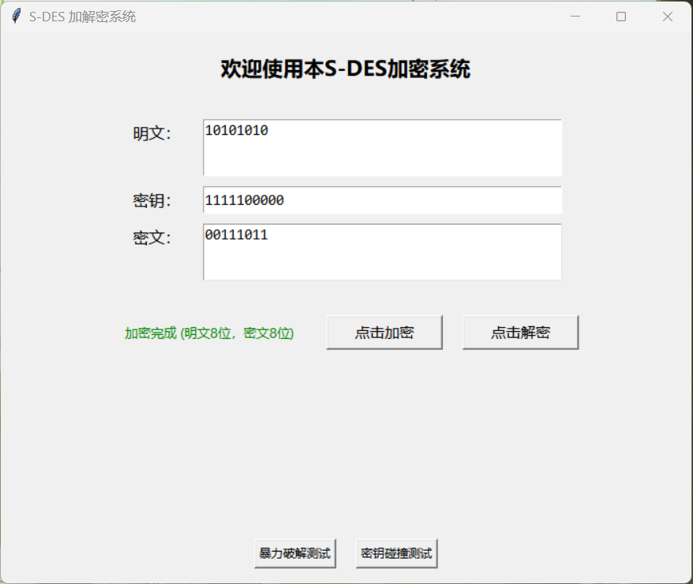 | 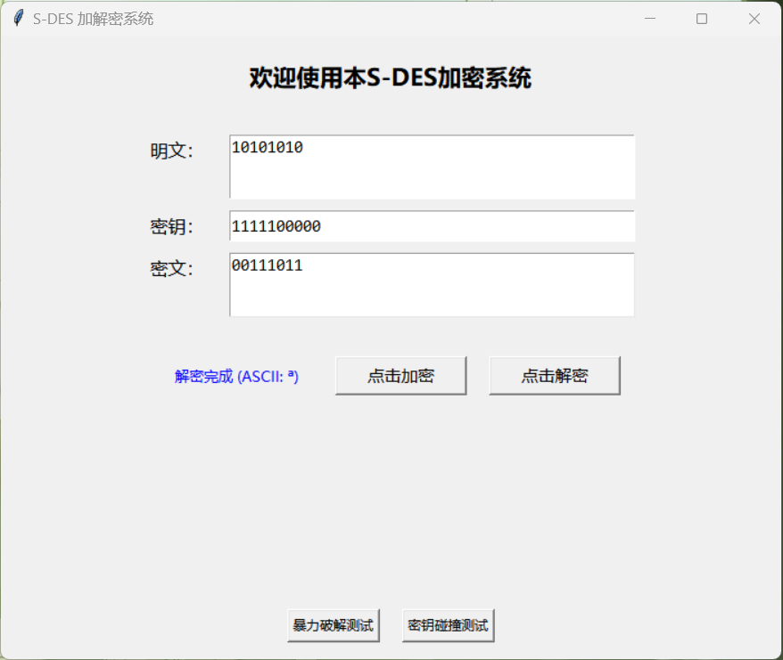 |

| 密钥输入检验                                | 长二进制串测试                               |
|:-------------------------------------:|:-------------------------------------:|
| 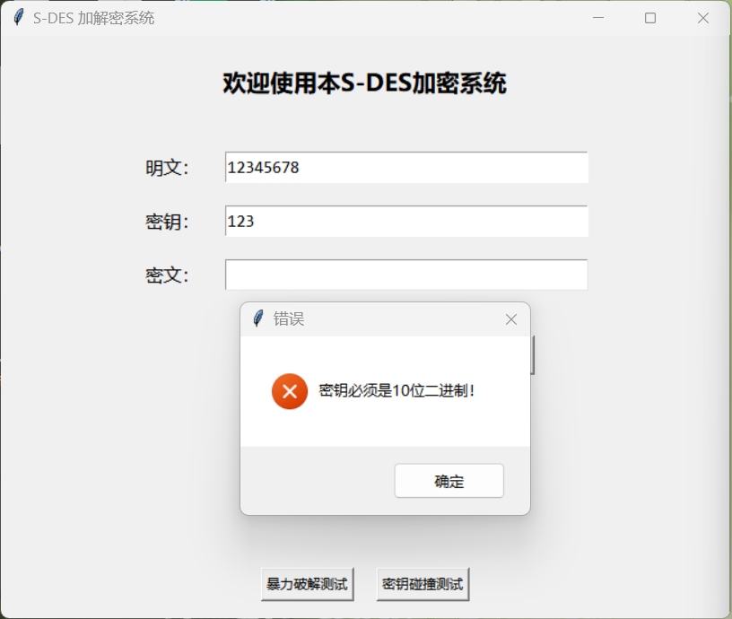 | 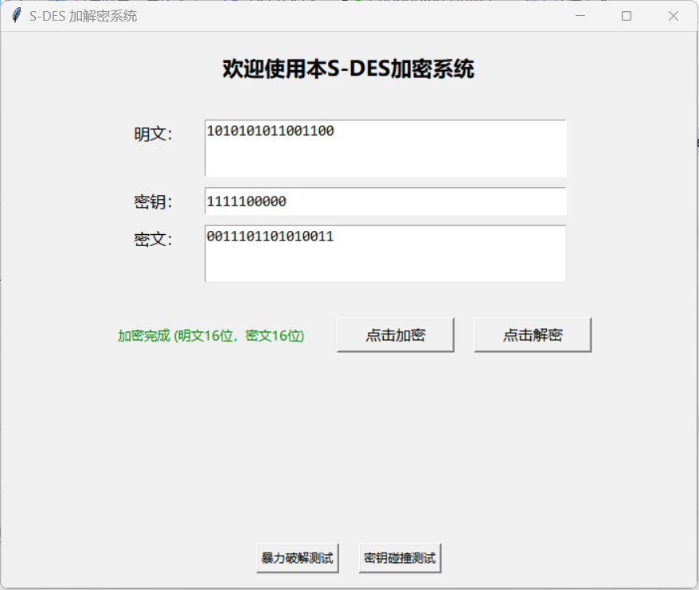 |

### 第 2 关：交叉测试

| 本组数据 1                              | 本组数据 2                              |
|:-----------------------------------:|:-----------------------------------:|
| 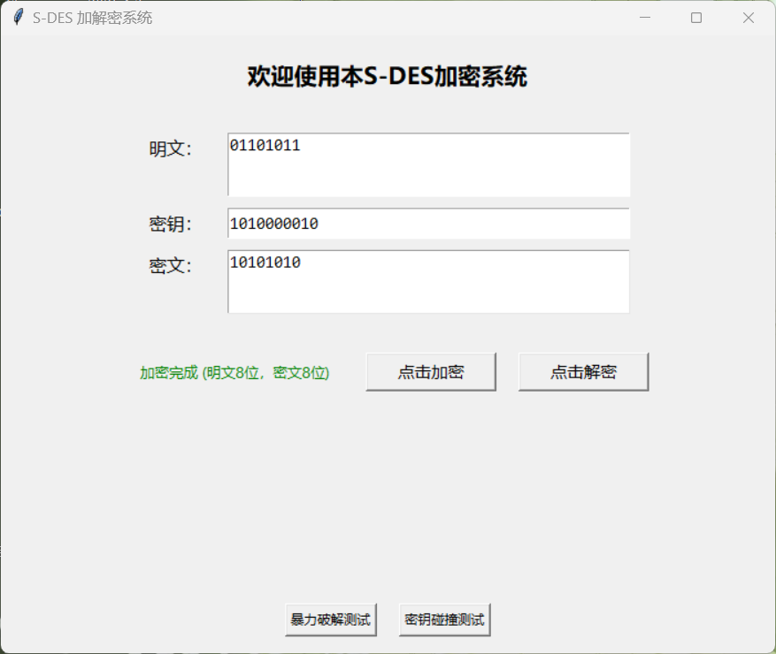 | 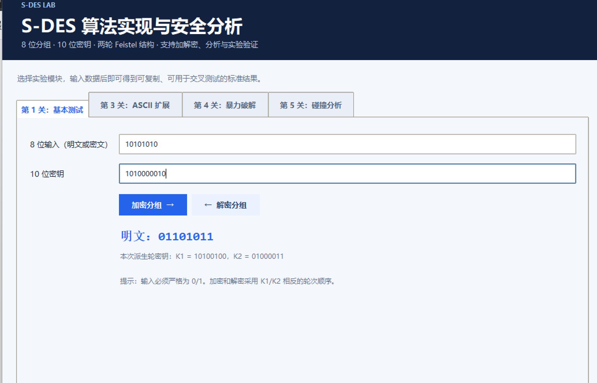 |

| B 组数据 1                             | B 组数据 2                             |
|:-----------------------------------:|:-----------------------------------:|
| 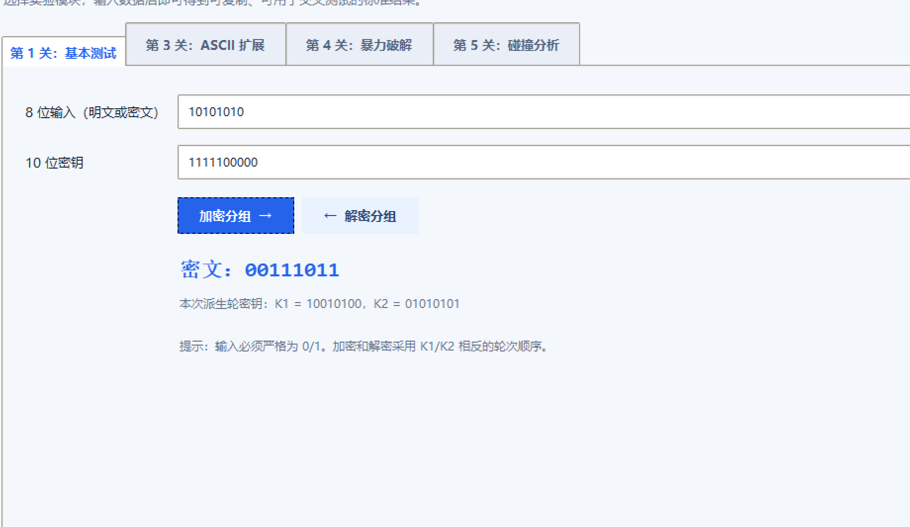 | 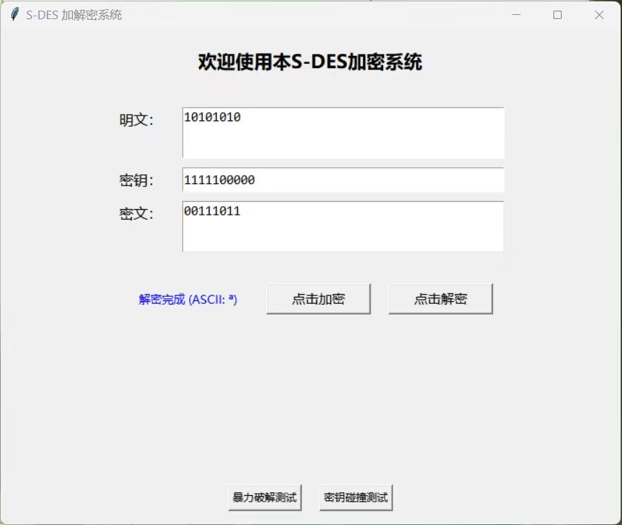 |

### 第 3 关：ASCII 字符串扩展

| 加密                               | 解密                               |
|:--------------------------------:|:--------------------------------:|
| 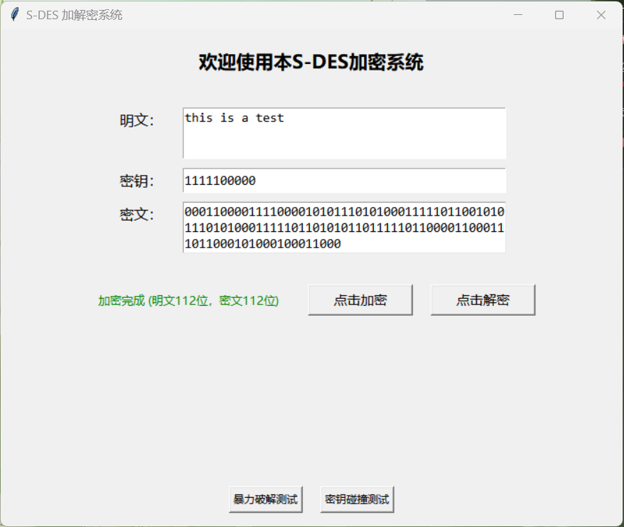 | 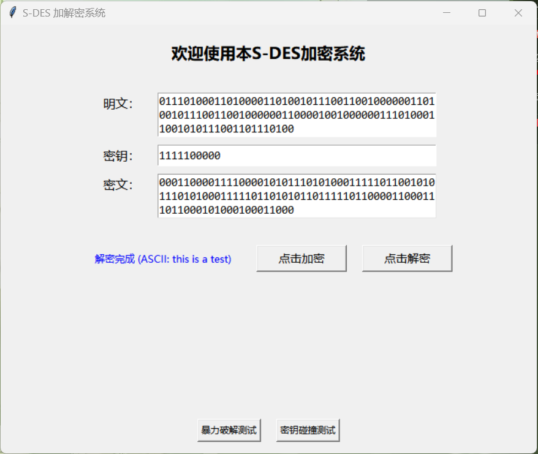 |

### 第 4 关：暴力破解

静态截图：

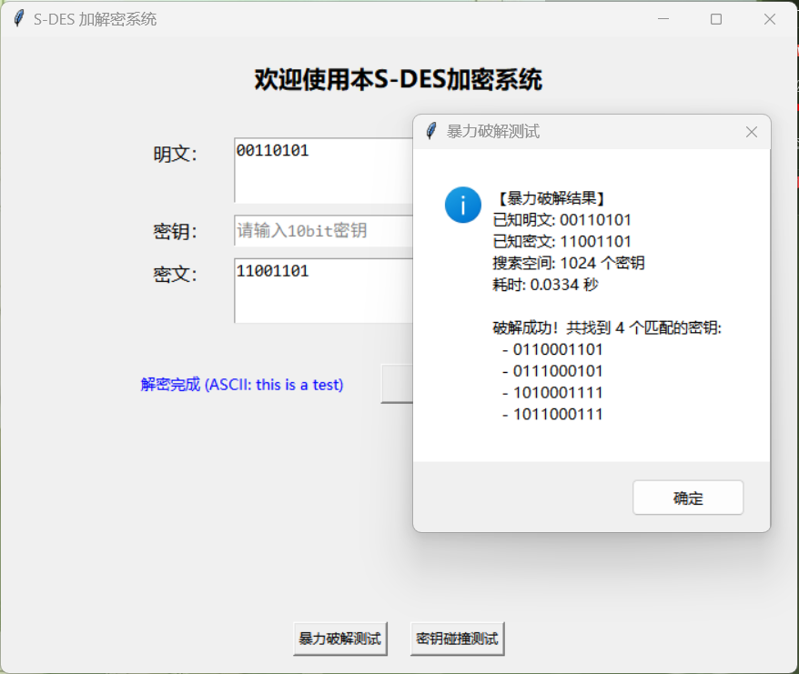

动图演示（含系统时间戳与耗时展示）：

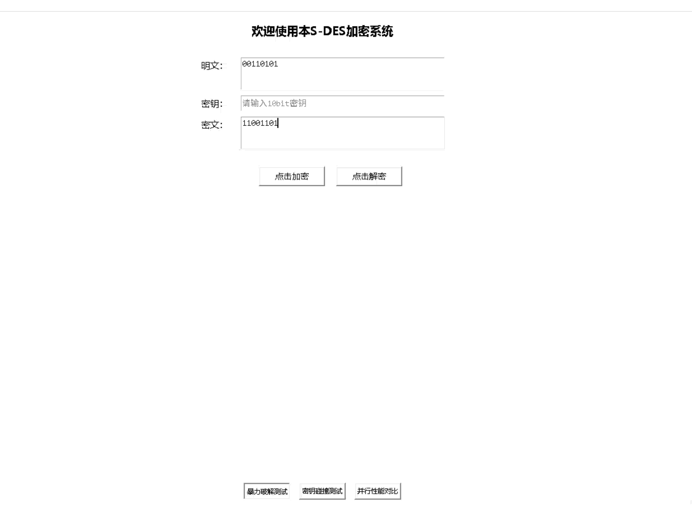

### 第 5 关：密钥碰撞封闭测试

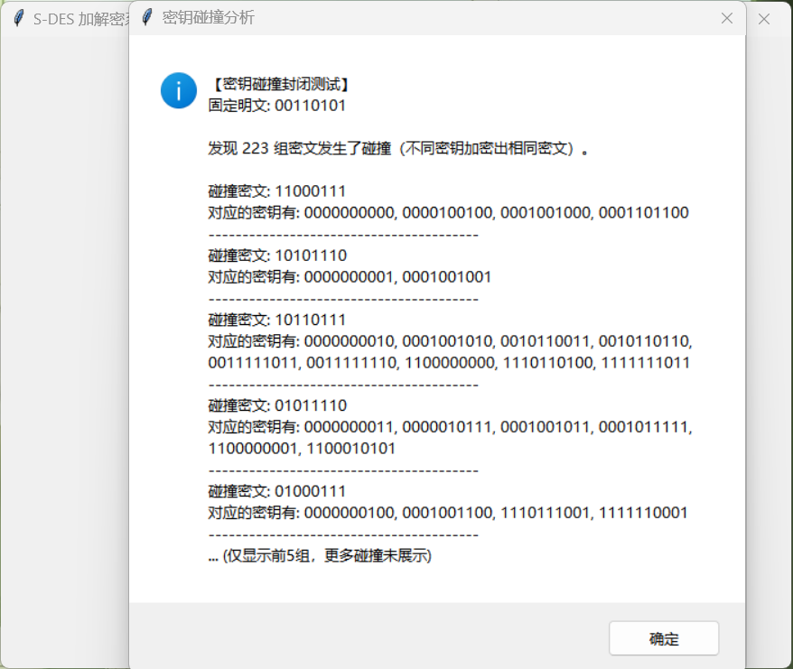

## ⚡ 并行性能结论（第 4 关补充实验）

S-DES 的密钥空间仅 2¹⁰ = 1024，单次完整破解只需约 0.03 秒，此时进程 / 线程的**启动开销会掩盖并行收益**。为观察并行化的真实效果，程序内置了"并行性能对比"功能：将每个候选密钥的验证代价放大 100 倍后（三种模式工作量完全相同）再对比，实测数据如下：

| 模式                       | 耗时       | 相对串行的加速比 | 说明                                     |
|:------------------------ |:-------- |:-------- |:-------------------------------------- |
| 串行（单线程）                  | 约 2.6 s  | 1.00x    | 性能基线                                   |
| 多线程（ThreadPoolExecutor）  | 约 2.4 s  | 约 1.06x  | 受 Python 全局解释器锁（GIL）限制，CPU 密集型任务几乎无法并行 |
| 多进程（ProcessPoolExecutor） | 约 0.75 s | 约 3.4x   | 绕开 GIL，真正利用多核，加速效果显著                   |

结论：本项目暴力破解默认采用**多进程**实现（按块切分密钥空间后并行扫描），在验证代价足够大时可获得接近 CPU 核心数的加速比；同时也保留了多线程与串行模式用于对照，并在界面中如实呈现上述结论。

## 📚 开发文档摘要

### 系统架构

- **核心算法模块 `SDESCore`**：置换、循环左移、异或、S 盒查表、密钥扩展、轮函数 F、加解密主流程（全部为纯函数，无副作用）
- **工具函数模块 `SDESUtils`**：ASCII ↔ 二进制转换、可打印性判定、暴力破解（多进程 / 多线程 / 串行）、多明密文对收敛、并行性能对比、密钥碰撞分析与统计
- **图形界面模块 `SDESGUI`**：界面布局、输入校验、事件响应、右键菜单、时间戳与结果弹窗

### 关键算法

- **密钥扩展**：P10 置换 → 拆分左右各 5 bit → 循环左移 1 位 → P8 压缩得 K1 → 再循环左移 2 位 → P8 压缩得 K2
- **轮函数 F**：EP 扩展（4→8 bit） → 与子密钥异或 → 左右各 4 bit 分别过 S1、S2 → SP 置换
- **加解密流程**：IP 置换 → 两轮 F 函数（中间 SW 交换左右）→ IP⁻¹ 逆置换；解密仅把子密钥顺序改为先 K2 后 K1

## 👥 贡献与提交

- **课程**：信息安全导论
- **作业**：S-DES 算法实现（第 1 次课作业）
- **组员（请补充完整）**：
  - 姓名：_____牙雁玮_____　学号：20241459
  - 姓名：_____张匀慈_　学号：______20241120____
  - 姓名：__________　学号：__________
- **提交日期**：2026 年 10 月

## 📄 许可证

本项目仅供学习与课程作业使用，遵循 MIT 许可证。如需引用，请注明出处。

---
